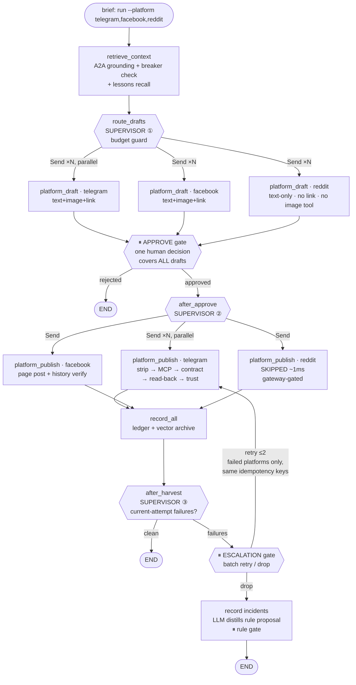
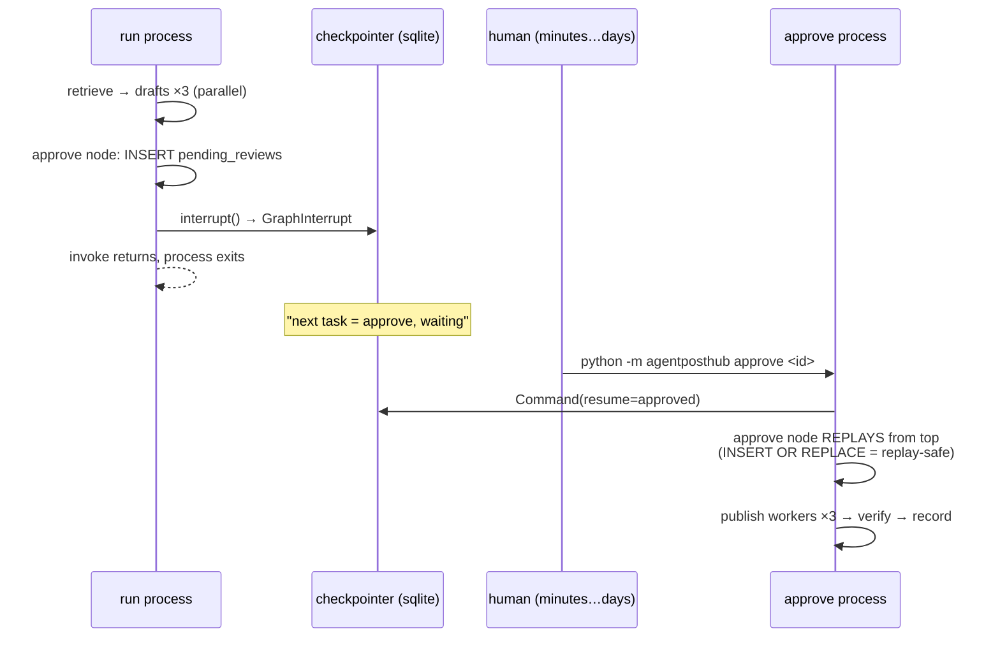

# Agent Flow

One task = one thread = one trace. The graph suspends twice at human
gates and resumes in a different process.

## Full flow



## The two invoke halves (durable human gate)

`interrupt()` is node-level suspension, not a blocked thread: the run
process exits, state lives in the checkpoint, and the approve process
replays the `approve` node from its top.



The approve node appears TWICE in the trace — one span per execution:
the suspension pass and the resume replay. The wall-clock gap between
them is the measurable human-gate latency.

## Send fan-out and the barrier

`route_drafts` returns a list of `Send(node, state_slice)` — the loop
only *declares* tasks; the engine executes them in the same superstep
(parallel), and the next node (`approve` / `record_all`) starts only
after ALL of them finish (superstep barrier). Total wall time is
`max(worker)` — the straggler sets the join time.

## Trace anatomy (true call order)

```bash
python -m agentposthub trace <task_id>
```

```
LangGraph                        ← invoke #1 root
 ├─ retrieve_context
 │    └─ site_planner        🔧 TOOL   (A2A grounding; failures visible)
 ├─ platform_draft ×3        (parallel, same-millisecond start)
 │    └─ deepseek_chat       🤖 GENERATION (model, tokens, tool_calls)
 ├─ dedup / after_dedup
 └─ approve ⏸                 ← graph suspends
        ╳ human-gate latency (directly measurable)
 LangGraph                        ← invoke #2 root (resume process)
 ├─ approve (replay) → after_approve   SUPERVISOR ②
 ├─ platform_publish ×3
 │    ├─ telegram   → composio_publish 🔧 → composio_read_back 🔧
 │    ├─ facebook   → composio_publish 🔧 (page-history verify)
 │    └─ reddit     → skipped ~1ms (gateway-gated, visible reason)
 └─ record_all → after_harvest         SUPERVISOR ③ → END
```

Span nesting is real OTel context propagation: manual spans adopt
their node (a span created inside `generate` becomes its child).
